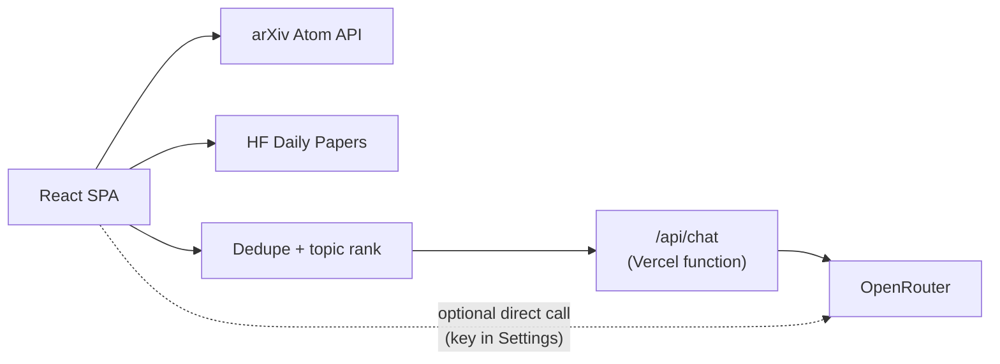

# PaperPulse

> AI research briefings for fast paper triage — fetch, rank, and summarize arXiv and Hugging Face Daily papers, then chat with any one of them.

Pick topic presets (LLMs, AI Agents, Diffusion, …) or type a custom subject, hit
**Analyze**, and PaperPulse pulls fresh papers, deduplicates and topic-ranks
them, and generates a structured briefing for each: TL;DR, key points, method,
results, impact score, and tags. Open any paper's chat to ask questions answered
from its full text, with citations.

Or switch to **Research** mode: a [LangGraph](https://langchain-ai.github.io/langgraphjs/)
agent plans arXiv queries for a topic, keeps only the papers it judges relevant,
extracts their key ideas, regroups those ideas into cross-paper themes (where the
papers agree and where they contradict), and writes a cited synthesis report.
Each run is saved as a knowledge base you can chat with.

## Stack

| Concern | Technology |
|---|---|
| Frontend | React 18, Vite 6 — no CSS framework, styles inlined as a JS template literal |
| AI | [OpenRouter](https://openrouter.ai) — any supported model |
| Research agent | LangGraph JS (`@langchain/langgraph`) running server-side in `api/agent.js`, streamed to the UI as SSE |
| RAG | Browser-side vector index (IndexedDB) with pluggable embeddings: a local transformers.js model (no key) or any OpenAI-compatible `/embeddings` endpoint |
| Paper sources | arXiv Atom API, Hugging Face Daily Papers JSON API |
| Full text | `arxiv.org/html/{id}` → `ar5iv` fallback, via CORS proxies |
| Deployment | Vercel — static site + Node serverless function |

## Quick start

Requires Node ≥ 20 and an [OpenRouter API key](https://openrouter.ai/keys).

```bash
npm install
cp .env.example .env.local     # add your API key and a random server access token
npm run dev
```

Open the URL Vite prints, usually <http://localhost:5173>.

`npm run dev` mounts the same `/api/chat` handler Vercel uses and loads
server-only values from `.env.local`. Alternatively, paste an OpenRouter key
into the app's **Settings** panel — the browser then calls OpenRouter directly,
bypassing the server route. Server-routed requests require the private access
token in Settings. Both credentials stay in tab memory and are cleared on reload;
keys saved in localStorage by earlier versions are removed automatically.

> **Never prefix the secret key with `VITE_`.** Vite bundles every `VITE_*`
> variable into the browser bundle. Only `VITE_OPENROUTER_MODEL` — a non-secret
> model id — is safe to expose that way.

## Commands

| Command | Does |
|---|---|
| `npm run dev` | Vite dev server (foreground) with the `/api/chat` and `/api/agent` handlers |
| `npm run build` | Production build to `dist/` |
| `npm run preview` | Preview the built bundle |
| `npm test` | Node test suite (`tests/*.test.js`) — API auth, arXiv parsing, agent graph |
| `make install` | `npm install` |
| `make run` / `make stop` / `make restart` | Run detached (PID in `.vite.pid`, logs in `.vite.log`) |
| `make status` / `make logs` | Process state / dev server logs |
| `make build` | Production build |

Override the port with `make run PORT=3000`.

## Features

| Feature | Details |
|---|---|
| **Topic presets** | 14 presets (LLMs, AI Agents, Reasoning, RAG, RLHF/Alignment, Multimodal, CV, Diffusion, Mech Interp, Efficiency/MoE, Robotics/VLA, AI Safety, Benchmarks, ML) backed by arXiv category codes and keyword lists |
| **Custom topics** | Free-text input; related preset terms are expanded before the arXiv query is built |
| **HF Daily source** | Toggle Hugging Face Daily Papers (community-upvoted) alongside arXiv |
| **Paper count** | 10, 20, or 30 per run |
| **Structured briefings** | TL;DR, 4 key points, method, results, impact (1–5 stars), tags, "why it matters" |
| **Impact filter** | Show only impact ≥ 3, ≥ 4, or exactly 5 |
| **Tag filter** | Click any generated tag to filter the digest |
| **Subject finder** | Re-ranks loaded papers in real time without a new API call |
| **Free-text filter** | Across title, authors, abstract, TL;DR, method, results, tags |
| **Paper chat** | RAG-style chat grounded in full paper text, evidence cited with `[E1]` ids |
| **Research agent** | LangGraph agent: query planning → relevance grading (with iterative query refinement) → idea extraction → cross-paper theme regrouping → parallel understand / challenge / practice / compare analyses → cited synthesis report with a self-review + revision pass, streamed live |
| **Knowledge base** | Research runs saved in `localStorage` (`pb_knowledge`); select runs and chat across them — the agent can also search arXiv and read papers mid-answer |
| **Paper figures** | The agent scrapes each kept paper's HTML render for its first figures (image + caption) and shows them on the paper rows |
| **Knowledge graph** | An interactive papers ↔ themes ↔ concepts graph per run: hover traces connections, click a paper to chat with it; plus a papers-by-year chart (categorical colors CVD-validated for both themes) |
| **RAG / semantic search** | Research runs and library sources are chunked, embedded, and stored in a browser-side vector index; each knowledge-chat question retrieves the best excerpts as cited `[E#]` evidence |
| **Library** | Add sources beyond research runs — an arXiv id, any public article URL (fetched and cleaned server-side), or pasted text — and they join the retrieval index |
| **Embedding platforms** | Choose in Settings: off (lexical only), a local in-browser model (`all-MiniLM-L6-v2` via transformers.js, ~25MB one-time download, fully private), or any OpenAI-compatible embeddings API (OpenAI, Jina, Mistral, Ollama, ...) |
| **Partial salvage** | Sections stream in as they finish; a failed or stopped run can be saved as a (marked) partial knowledge run |
| **Follow-up research** | Every open question the critic raises has a "Research this →" button that seeds a new agent run |
| **Briefing export** | Copy or download the whole research briefing (papers, themes, concepts, comparison table, critique, practice, synthesis) as Markdown |
| **Bookmarks** | Star papers into a Saved tab, persisted in `localStorage` |
| **Markdown export** | Copy or download the digest |
| **Dark mode** | Persisted across sessions |
| **Result caching** | Last digest restored on reload, so you never start blank |

### Keyboard shortcuts

| Key | Action |
|---|---|
| `Escape` | Close the paper chat modal |
| `Enter` (topic input) | Start a new Analyze run |

## Project structure

```
api/
  chat.js               # Vercel serverless function — proxies OpenRouter
  agent.js              # Vercel serverless function — LangGraph research agent (SSE)
  _lib/                 # shared server modules (not deployed as routes)
    auth.js             #   access-token / browser-key auth, shared with chat.js
    graph.js            #   LangGraph research graph + knowledge-chat tool loop
    arxiv.js            #   Node-side arXiv search, Atom parsing, full-text fetch
    model.js            #   ChatOpenAI configured for OpenRouter
    text.js             #   pure text/scoring helpers ported from App.jsx
tests/                  # node:test suite (npm test)
src/
  App.jsx               # ★ the entire app: fetching, ranking, UI, chat (~3k lines)
  main.jsx              # React entry point
public/                 # favicon.svg, PWA icons, site.webmanifest
arxiv-batch-analyzer.jsx  # legacy 3-line re-export shim → src/App.jsx
index.html
vite.config.js
vercel.json             # build config + serverless function + SPA rewrite
```

`src/App.jsx` is a deliberate single-file app — data fetching, ranking, every
component, and the chat system live in one ~3,000-line module. Know that before
planning a change. The root `arxiv-batch-analyzer.jsx` is a compatibility shim
for older imports and nothing references it.

## Architecture



The serverless function exists so the API key stays server-side. The direct
browser path is opt-in and only used when you paste a key into Settings.

### How the research agent works

`POST /api/agent` runs a LangGraph `StateGraph` server-side and streams
data-only SSE frames (`phase`, `log`, `papers`, `idea_progress`, `partial`,
`tool`, `result`, `error`, `done`). `partial` frames carry each section
(ideas, themes, concepts, critique, practice, comparison, report) as soon as
it is ready, so the client can salvage and save a partial run when a later
step fails or the run is stopped:

```
plan_queries → search_arxiv → grade_relevance ──┬→ extract_ideas → regroup_themes ─┬→ understand_concepts ─┬→ synthesize → review_report ─┬→ END
                    ▲                           │                                  ├→ challenge_claims ────┤                              │
                    └────── refine_queries ←────┘                                  ├→ practical_guide ─────┤               revise_report ←┘
                     (too few relevant papers,                                     └→ compare_papers ──────┘           (self-review found issues;
                      max 2 rounds)                                                 (four passes in parallel)           at most one revision)
```

- **Research** (`{action: "research", topic}`): the model fans the topic out
  into complementary arXiv queries, candidates are lexically prefiltered, then
  LLM-graded 0–100 for relevance (threshold 70). Ideas (claims, methods,
  findings, limitations) are extracted per paper and regrouped into
  cross-paper themes with agreements and contradictions. Three analysis passes
  then run in parallel — **understand** (key concepts explained plainly),
  **challenge** (a skeptical review: weaknesses, assumptions, conflicting
  claims, gaps, open questions), **practice** (scenario → approach
  recommendations, pitfalls, resources), **compare** (a per-paper
  approach/contribution/evidence/limitation matrix), and **figures** (no LLM —
  scrapes each kept paper's HTML render for its first figures) — before a final markdown
  report with `[n]` citations (out-of-range citations are stripped
  mechanically). The agent then **reviews its own report** against the
  extracted ideas (unsupported claims, mis-citations, ignored disagreements)
  and revises it at most once when the review finds real issues. Hard caps
  bound every run (≤8 queries, ≤80 graded papers, ≤16 extracted papers, ≈29
  LLM calls worst case). `options.deep` also feeds each paper's full text into
  idea extraction.
- **Chat** (`{action: "chat", messages, knowledge}`): a tool-loop agent with
  `consult_knowledge` (lexical search over the knowledge payload the browser
  sends), `search_arxiv`, and `read_paper`. Knowledge lives only in the
  browser (`pb_knowledge`); the server holds no state.

- **Ingest** (`{action: "ingest", url}`): fetches one source for the library —
  an arXiv id via the paper pipeline, or a public article URL stripped to
  readable text server-side. Guarded against SSRF: http(s) only, default
  ports, and private/internal hosts (localhost, RFC-1918, link-local metadata
  addresses, `.local`/`.internal`) are refused before any request is made.

Auth matches `/api/chat` (`Authorization: Bearer <PAPERPULSE_ACCESS_TOKEN>`),
plus one addition: a user's own key can be sent as `X-OpenRouter-Key` — the
graph still runs server-side, and the key is only forwarded to OpenRouter.
Server-funded requests always use the server's `OPENROUTER_MODEL`; only
own-key requests may pick a model.

### How the RAG system works

The knowledge base lives in the browser, so the vector index does too:

1. **Index**: each research run (papers, ideas, themes, critique, practice,
   report) and each library source is chunked (~1,500 chars, 200 overlap),
   embedded, and stored in IndexedDB (`pb_rag`) with normalized vectors.
2. **Embed**: Settings picks the platform — `local` runs
   `Xenova/all-MiniLM-L6-v2` in the browser via transformers.js (code-split;
   nothing loads unless enabled), `remote` calls any OpenAI-compatible
   `/embeddings` endpoint with your key (held in tab memory only), `off`
   falls back to lexical search everywhere.
3. **Retrieve**: before each knowledge-chat message the client embeds the
   question, cosine-searches the chunks of the selected runs + all library
   sources, and sends the top excerpts with the request.
4. **Ground**: the server agent receives them as `[E#]` evidence blocks in
   its system prompt and cites them; the `consult_knowledge` tool still
   covers the structured knowledge (and un-indexed sources lexically), and
   `search_arxiv`/`read_paper` fill gaps live.

### How paper chat works

1. Fetch the full HTML render from `arxiv.org/html/{id}`, falling back to
   `ar5iv`, via CORS proxies (direct → `corsproxy.io` → `api.allorigins.win`).
   If all fail, chat degrades to the abstract plus the generated briefing.
2. Split the text into structured sections (Abstract, Introduction, Method,
   Results, …) then into overlapping ~1,700-character chunks.
3. For each message, select the top 7 chunks by a BM25-style token score with
   intent boosting — a question about "limitations" boosts limitation and
   discussion sections.
4. Send those chunks plus up to 12 recent turns to the LLM, with a system prompt
   requiring `[E1]`-style evidence citations and an explicit "the evidence
   doesn't support this" escape hatch.
5. Persist chat history per paper in `localStorage`.

### Ranking

`scorePaperForTopic` weights: arXiv category match (+8 each), phrase match in
title (+18) and abstract (+8), token match in title (+5) and abstract (+2), plus
recency, HF upvotes, and quality signals ("state of the art", "benchmark", …).

## Configuration

| Variable | Required | Purpose |
|---|---|---|
| `OPENROUTER_API_KEY` | Yes (server) | OpenRouter secret key — used only by `api/chat.js` and `api/agent.js` |
| `PAPERPULSE_ACCESS_TOKEN` | Yes (server) | Private access token, at least 32 characters; generate with `openssl rand -hex 32`. Without it, server chat is disabled. Never expose it with a `VITE_` prefix. |
| `OPENROUTER_MODEL` | No | Server-side model for `/api/chat`. The client model is ignored for server-routed requests. |
| `OPENROUTER_BASE_URL` | No | OpenAI-compatible API root for the chat/agent backends (default `https://openrouter.ai/api/v1`). Point it at OpenAI, Ollama, vLLM, Groq, ... |
| `VITE_OPENROUTER_MODEL` | No | Browser default shown in the Settings panel |

Both model variables fall back to `deepseek/deepseek-v4-pro` in code.

### localStorage keys

`pb_cache` (last digest) · `pb_bookmarks` · `pb_paper_chats` · `pb_knowledge`
(saved research runs, library sources, knowledge chat) · `pb_emb_provider` /
`pb_emb_url` / `pb_emb_model` (embeddings platform; the key itself is never
stored). The vector index lives in IndexedDB as `pb_rag`. Clear them in
DevTools → Application for a clean state.

## Deploy on Vercel

1. Push to GitHub and [import the project](https://vercel.com/new).
2. Under **Project Settings → Environment Variables**, add `OPENROUTER_API_KEY`
   and a randomly generated `PAPERPULSE_ACCESS_TOKEN`
   (and optionally `OPENROUTER_MODEL`, `VITE_OPENROUTER_MODEL`).
3. Deploy. Enter the private access token in Settings to use server-funded chat.
   Public visitors can enter their own OpenRouter API key instead.

`vercel.json` handles the rest: `npm run build` → `dist`, `api/chat.js` (30s
max duration) and `api/agent.js` (300s — a research run makes many LLM calls)
as serverless functions, and an SPA rewrite sending all non-API routes to
`index.html`. If your plan rejects `maxDuration: 300` at deploy time, lower it
to your plan's limit (classic Hobby caps at 60s).

## Privacy and deployment security

Chat messages, paper excerpts, and analysis prompts are sent to OpenRouter and
its selected model provider. Paper-fetch fallback services (`corsproxy.io` and
`api.allorigins.win`) receive requested URLs, which can include research queries.
Bookmarks, digests, and paper chats persist in browser localStorage; clear site
data to remove them. Credentials are held only in tab memory.

The server access token is intended for a small, trusted group. Do not publish
it or embed it in the frontend. Authentication does not impose usage quotas:
configure provider spending limits and deployment-level rate limiting before
sharing server-funded access widely.

Older revisions supported API keys in frontend environment variables. If those
revisions were deployed with real keys, revoke those keys and remove old
accessible deployments. Updating this source cannot clean existing bundles.

## License

Private project — see `package.json`.
